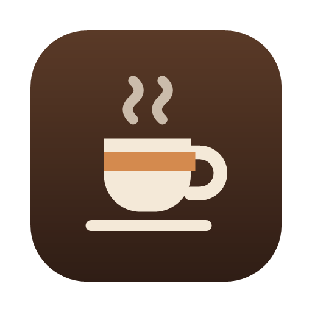
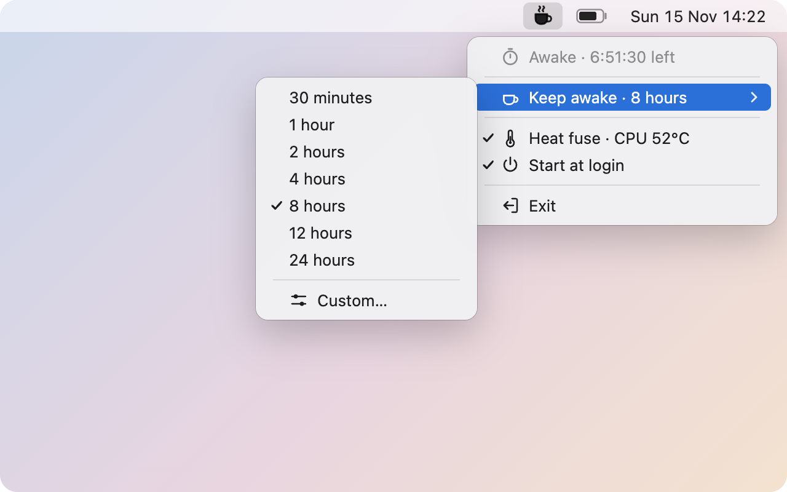
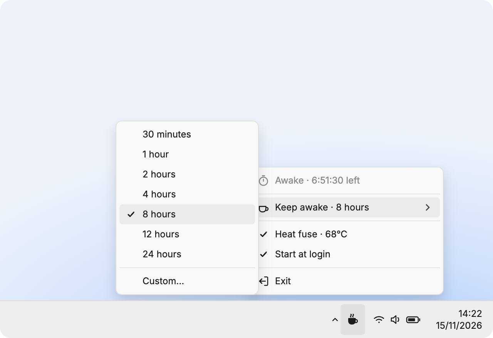
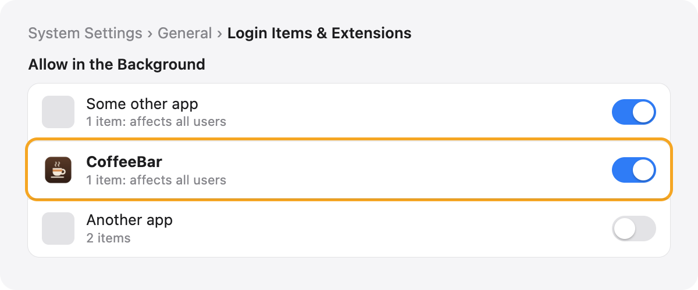

<div align="center">



# coffee-bar

**Keep your laptop awake for as long as you choose, even with the lid closed.**

A tiny menu-bar (macOS) and tray (Windows) app. Pick a time, close the lid, walk away.<br>
When the time is up, everything goes back to normal.

[](https://github.com/KaanEmec/coffee-bar/releases/latest)


[](LICENSE)

</div>

<table>
<tr>
<th>macOS</th>
<th>Windows</th>
</tr>
<tr>
<td>
<picture>
  <source media="(prefers-color-scheme: dark)" srcset="docs/macos-dark.png">
  
</picture>
</td>
<td>
<picture>
  <source media="(prefers-color-scheme: dark)" srcset="docs/windows-dark.png">
  
</picture>
</td>
</tr>
</table>

## ⚡ Install

### 🍎 macOS (13 or newer)

Paste this into **Terminal**:

```bash
curl -fsSL https://github.com/KaanEmec/coffee-bar/releases/latest/download/install.sh | bash
```

**After installing (one time):** the installer opens System Settings for you. Under **Allow in the Background**, turn on **CoffeeBar**. That's what lets it stay awake with the lid closed. Without it, CoffeeBar still keeps the Mac awake, as long as the lid stays open.

<picture>
  <source media="(prefers-color-scheme: dark)" srcset="docs/approve-dark.png">
  
</picture>

Can't find it later? It's at **System Settings → General → Login Items & Extensions**.

### 🪟 Windows (10 or 11, x64 or ARM64)

Paste this into **PowerShell** (no admin rights needed):

```powershell
irm https://github.com/KaanEmec/coffee-bar/releases/latest/download/install.ps1 | iex
```

Run the same line again any time to **update**. The installers check every download against `SHA256SUMS`.

## ☕ How to use it

1. Click the **cup** in the menu bar or tray.
2. Choose **Keep awake ›** and a duration: 30 minutes up to 24 hours, or **Custom…** (e.g. `45`, `90m`, `2h`, `1h30m`, `1:30`).
3. That's it. The cup gets steam while it's active, and the menu counts down.

Click the checked duration again to stop early.

## ✨ What it does

| | |
|---|---|
| 💤 **Lid closed? Still awake.** | Downloads, builds and remote sessions keep running with the lid shut. |
| 🌙 **Screen still turns off** | Only the computer stays awake; the display sleeps as usual and saves power. |
| ⏱️ **Always ends** | When the time is up the laptop sleeps normally again, straight away if the lid is closed. |
| 🌡️ **Heat fuse** | If the laptop overheats (say, running hot in a closed bag), it stops and puts the laptop to sleep. On by default. |
| ↩️ **Leaves no trace** | Every setting it changes is restored when the timer ends, when you quit, at shutdown and even after a crash. |
| 🪶 **Tiny and native** | Swift on macOS, Rust on Windows. No window, no account, no telemetry. |

## 🗑️ Uninstall

**macOS**

```bash
curl -fsSL https://github.com/KaanEmec/coffee-bar/releases/latest/download/install.sh | bash -s -- --uninstall
```

**Windows**

```powershell
& ([scriptblock]::Create((irm https://github.com/KaanEmec/coffee-bar/releases/latest/download/install.ps1))) -Uninstall
```

<details>
<summary><b>More install options</b></summary>

&nbsp;

| | macOS (`install.sh`) | Windows (`install.ps1`) |
|---|---|---|
| A specific version | `… \| bash -s -- --version 0.1.0` | `& ([scriptblock]::Create((irm …/install.ps1))) -Version 0.1.0` |
| Don't open it after installing | `… \| bash -s -- --no-launch` | `… -NoLaunch` |
| Start at login | from the menu: **Start at login** | from the menu, or `… -StartAtLogin` |
| Installs to | `/Applications/CoffeeBar.app` | `%LOCALAPPDATA%\Programs\coffee-bar` + Start Menu shortcut |

**Manual download:** grab the zip for your system from the [latest release](https://github.com/KaanEmec/coffee-bar/releases/latest). The macOS app is signed with a Developer ID but not yet notarized, so macOS blocks a browser-downloaded copy the first time (allow it under **System Settings → Privacy & Security → Open Anyway**). The one-liner above avoids that.

</details>

<details>
<summary><b>How it works</b></summary>

&nbsp;

| | macOS | Windows |
|---|---|---|
| Stay awake | `IOPMAssertion` (prevent idle system sleep) | `SetThreadExecutionState` |
| Lid closed | `pmset disablesleep` through a tiny root helper (`SMAppService`), approved once | Power plan lid action set to *Do nothing*, then restored |
| Crash safety | The helper restores sleep the moment the app's connection drops, and again at boot | A `RunOnce` entry restores the lid action at the next login |
| Heat fuse | CPU die (Apple Silicon / Intel), battery, thermal state | Hottest ACPI thermal zone, battery (if reported) |

Building from source: see [BUILDING.md](BUILDING.md).

</details>

## License

[MIT](LICENSE)
